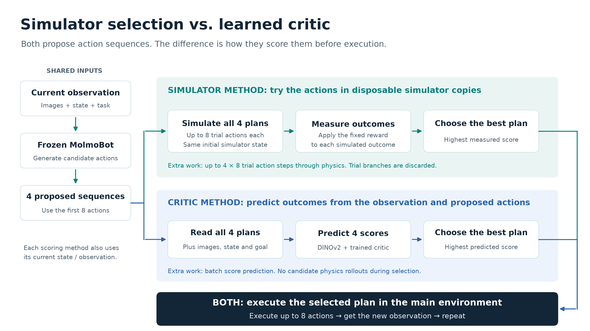
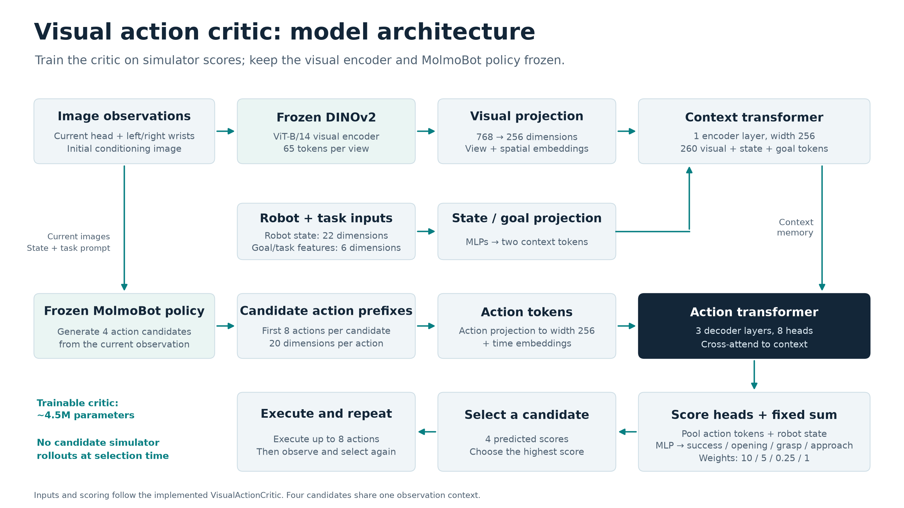
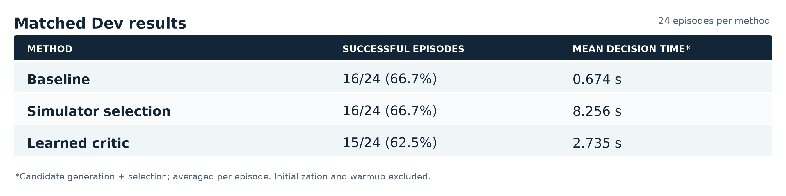
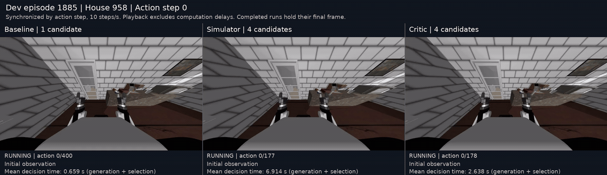

# MolmoBot-p: Action candidate selection — November 2 collection

Presentation archive label: 2026-11-02, as requested. The results below include
the November 3 Dev comparison; the folder label is not the experiment date.
This is the historical simulator-selection/critic direction, separate from the
current pose-learning project update.

## MolmoBot-p: Choosing better actions from a frozen robot policy

Goal: Improve simulated door opening without retraining the base policy.

Use the pretrained MolmoBot multitask policy to generate candidate action sequences from the current observation.

Compare three approaches: execute one candidate directly, select with simulator rollouts, or select with a learned critic.

Pipeline: Observe → Generate candidates → Score and select → Execute up to 8 actions → Update and repeat.

Research question: Can candidate selection improve task success, and can a critic reduce the cost of simulator selection?

## MolmoBot-p: Three action-selection methods

Baseline: Generate 1 candidate and execute its next actions directly.

Simulator selection: Simulate the eight-action prefixes of 4 candidates and select the highest-scoring candidate.

Simulator score: Task success, door-opening progress, grasping and handle approach.

Learned critic: Predict scores for 4 candidates from images, robot state and actions, then execute the highest-scoring candidate.

Both selectors generate 4 candidates; the critic replaces simulator branch evaluation during selection.

Each method repeats selection after executing up to 8 actions, using the updated observation.

## MolmoBot-p: Dataset and critic training

Data: 120 benchmark starts across 40 simulated houses.

House-disjoint split: 72 Train / 24 Dev / 24 final Eval episodes.

Collect training examples containing the current observation, candidate action sequence and its simulator score.

Critic architecture: Frozen DINOv2 visual features + robot state + action transformer; approximately 4.5M trainable parameters.

Train the critic on Train examples and select its checkpoint using Dev ranking performance.

Train three independent critic seeds; use the selected single seed-44 critic for the closed-loop comparison.

Keep the pretrained MolmoBot policy and simulator scoring function fixed; reserve Eval for final evaluation.

## MolmoBot-p: Visual action critic architecture

Four image views pass through a frozen DINOv2 encoder; visual tokens combine with robot-state and goal tokens in a context transformer.

The first eight actions of each candidate become action tokens; three transformer decoder layers cross-attend to the observation context.

Score heads predict success, opening progress, grasping and handle approach; their fixed weighted sum ranks the four candidates.

Execute the highest-scoring candidate's next actions, then repeat from the new observation.

## MolmoBot-p: Matched evaluation and initial results

Evaluate all three methods on 24 shared Dev starts: 72 completed rollouts with matched initial states, targets, policy checkpoint and a 400-action limit.

Use the same GPU within each episode's three-method comparison; measure decision time as candidate generation + selection, excluding initialization and warmup.

Results: Baseline 16/24 successes, simulator selection 16/24, and learned critic 15/24.

Computation: The critic makes decisions approximately 3× faster than simulator selection.

Task performance: Neither selector improved the overall baseline Dev success rate.

Individual improvement: In episode 1885, baseline failed; simulator succeeded in 177 actions and critic in 178 actions.

Current stage: Matched Dev evaluation complete; use paired videos to inspect failures before final held-out Eval.

## MolmoBot-p: Example: baseline failure, critic success

Episode 1885 uses the same initial state and task for all three methods.

Baseline failed within the action budget; simulator selection succeeded in 177 actions and the critic in 178 actions.

The animation is the previously exported comparison at 2× playback speed.

This example illustrates a recovered failure; the overall Dev results remain those reported on Slide 5.

